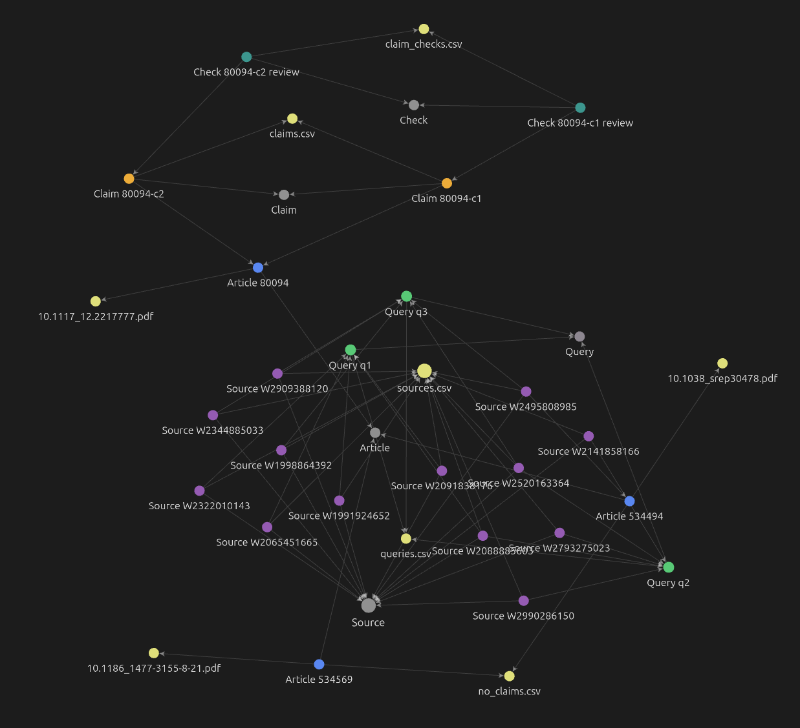
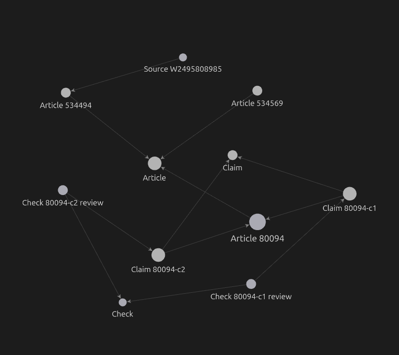

# ДЗ 1. Среда и контекст

Курс ШАД «ИИ-ассистенты для исследователя. AI4Science», осень 2026. Автор: Антон Попов.

Тема проекта: **Изучение научной литературы на тему того, что статьи о лазерно-абляционном синтезе коллоидных растворов золотых наночастиц утверждают о
зависимости размера наночастиц от плотности энергии (флюенса) и что
показывают их собственные данные**. Иными словами, на конференциях люди довольно уверенно говорят, о том, что существует определенная зависимость среднего размера наночастиц золота от энергии или флюенса лазерных импульсов, при этом довольно часто на графиках, которые публикуются в статьях, эта зависимость не прослеживается. Цель проекта - сравнить текстовые утверждения в статьях с их собственными данными, чтобы понять, насколько эти утверждения соответствуют реальным данным.

Как устроен репозиторий:

- `main`: только проект. Этот отчёт описывает `main`, и ссылки на его файлы
  относительные.
- Сданное состояние — метка [`hw1`](https://github.com/Kaldarinz/ai4science_proj/tree/hw1)
  на `main`. Если `main` уйдёт вперёд, откройте отчёт по метке: его
  относительные ссылки тогда ведут на файлы того же коммита.
- ветки `week-4`, `week-5`: практика соответствующих недель. Эти ветки я в `main` мерджить не
  планирую. То, что пригодилось, я перенёс в `main` (онтология, граф, отчёт о поиске по библиотеке).

## 0. Где что лежит

Сразу укажу, что я изменил логику того, как агент работает с онтологией и графом знаний, так как при тестовых прогонах оказалось, что то, что он генерирует очень ненадежно, если нет строгих проверок, поэтому фактически мне пришлось сделать реализацию алгоритмической генерации графа знаний на основе того, что агент пишет в промежуточные файлы, а сами эти файлы валидируются на соответствие онтологии. По сути это сейчас некий костыль, поскольку можно было бы разрешить агенту напрямую генерировать заметки и проверять корректность самих заметок, но это я планирую поправить в дальнейшем.

| Требование ДЗ 1 | Где | § |
|---|---|---|
| договор AGENT.md | [`AGENTS.md`](AGENTS.md) | 2 |
| онтология и граф понятий | [`ontology.yaml`](ontology.yaml), [`ontology/`](ontology), [`notes/`](notes), генератор [`tools/graph.py`](tools/graph.py) | 3 |
| примеры запросов к локальному контексту | [`tools/ask.py`](tools/ask.py), вывод в §4 | 4 |
| поиск по личной библиотеке, внешний граф | [`week-5:reports/my_search_report.md`](https://github.com/Kaldarinz/ai4science_proj/blob/67444f3c99220cc4645af51fb4254b557cde0ccd/reports/my_search_report.md), [`results/`](results) | 5 |
| журнал работы | [`diary.md`](diary.md) | 6 |

| Неделя | Артефакт недели (syllabus §4) | Где |
|---|---|---|
| 1 | среда + первый цикл «порождение → проверка» | §1; [`checks/check.py`](checks/check.py), журнал 2026-10-04, 2026-10-08 |
| 2 | разметка цикла вызова инструментов + трёхуровневое сжатие статьи | журнал 2026-10-08 (опыт «без AGENTS.md / с AGENTS.md») |
| 3 | AGENT.md + навигационные пометки | §2: [`AGENTS.md`](AGENTS.md), [`memory/`](memory), спецификации в [`checks/`](checks) |
| 4 | онтология + мини-граф (≥ 10 узлов) | §3 |
| 5 | поиск по библиотеке + запрос к внешнему графу | §5 |

## 1. Задача и среда

**Пайплайн работы**

- Агент читает PDF статьи и выписывает текстовые (это важно!) утверждения о зависимости размера от
  флюенса (энергии, мощности, интенсивности) в
  [`results/claims.csv`](results/claims.csv) с дословной цитатой и страницей.
  Если утверждений нет, он пишет одну строку в
  [`results/no_claims.csv`](results/no_claims.csv) с ближайшим предложением
  и причиной.
- [`checks/check.py`](checks/check.py) находит каждую цитату на её странице
  и проверяет, что результаты закоммичены. Код возврата 0 — критерий
  готовности для агента.
- Часть статей размечена мной вслепую, до запуска агента (их пока мало, но будут добавляться дальше). По этой разметке
  я считаю точность и полноту (`check.py --gold`; агент этот режим не
  запускает).
- Запланировано реализовать позднее: получение численных данных, с которыми будет происходить сравнение текстовых утверждений. У меня есть собственная база данных (ablation_db - postgresql + GUI интерфейс, которые крутятся на моём домашнем сервере), которая содержит структурированные записи об экспериментах, которые описаны в статьях. Я планирую реализовать MCP сервер, который в том числе будет возвращать агенту серии данных, в которых единственной переменной является флюенс или энергия лазерных импульсов, агент будет эти зависимости сравнивать с найденными им текстовыми утверждениями и делать вывод о том, насколько они соответствуют друг другу. 

**Среда.**

- Изоляция на уровне ОС ([`ops/isolation.sh`](ops/isolation.sh)): агент
  работает как пользователь `aiagent` в группе `aiproj`. Писать он может
  только в `results/ src/ tests/ memory/ diary.md`; `data/`, `checks/`,
  `tools/`, онтология и граф для него только для чтения. Ключей и `sudo` у
  него нет, `git push` невозможен.
- MCP-модуль `research` (OpenAlex, Wikidata) установлен в агента, а не в
  проект. Ключ OpenAlex лежит вне репозитория.

**Первый цикл (неделя 1).** 2026-10-04 агент извлёк из статьи 80094 два
утверждения. Я проверил их вручную и принял; агент назвал их
«проверенными», хотя проверок ещё не было. Отсюда `check.py`
(2026-10-08): цитату теперь находит скрипт, а не слово агента.

## 2. Договор `AGENTS.md`

Полный текст: [`AGENTS.md`](AGENTS.md). Он рассчитан на агента, поэтому
английский.

**Устройство.**

- §0: цель и три вида задач — извлечение утверждений, сравнение с данными,
  литература (OpenAlex).
- §1: критерий готовности для каждого вида — команда, которая должна вернуть
  0: `check.py --article <id>` или `tools/graph.py --validate`.
- §2–3: карта проекта, инструменты, права записи.
- §4: запреты. Каждый помечен тем, что его обеспечивает:
  - `[env]` — права ОС, агент не может нарушить запрет;
  - `[call]` — инструмент не подключён;
  - `[window]` — только текст в окне контекста.

  Так видно, какие запреты держатся сами, а какие — только на "честном слове"
  модели.
- §5–7: протокол работы, память, бюджет шагов и эскалация.

**Детали — в спецификациях**, которые агент читает, но не может менять:

- [`checks/claims_spec.md`](checks/claims_spec.md) — что считать
  утверждением;
- [`checks/results_spec.md`](checks/results_spec.md);
- [`checks/literature_spec.md`](checks/literature_spec.md).

**Навигационные пометки и память (неделя 3).**

- [`memory/<article_id>.md`](memory): где в статье результаты, какие
  предложения отвергнуты и почему, вопросы ко мне.
- `memory/lessons.md`: правила, общие для всех статей.
- В память запрещено писать значения из базы и выводы сравнения: извлечение
  должно оставаться слепым к ним.

**Как договор менялся.** Каждое нарушение становилось строкой в договоре
или, лучше, проверкой в скрипте.

| Что сделал агент | Что изменено |
|---|---|
| не закоммитил результат, гонял чужие проверки (2026-10-08) | критерий = `check.py --article` + коммит |
| сам записал «принято» в журнал (неделя 4) | запрет 9: вердикт пишет только человек |
| мог прочитать ручную разметку | запрет 3 (разметка, её история в git, `check.py --gold`); упоминание убрано из журнала, история переписана |
| запущен не из корня проекта, полез в `/` и в домашний каталог | запрет 4: ничего вне корня проекта |
| загрузил встроенный навык `literature` (web_search → pdf_download) | `literature_spec.md`: навык не загружать |
| писал CSV через `cat >>`, строки склеились | только модуль `csv`; `--validate` падает без перевода строки в конце |
| не закоммитил `diary.md` | `--validate` проверяет коммит `results/` и `diary.md` |
| пересказал абстракты в журнале (утечка для извлечения) | в журнале только номера запросов и числа; `--validate` падает, если журнал называет W-id источника |

## 3. Онтология и граф

[`ontology.yaml`](ontology.yaml): 7 классов, 10 свойств, 10 атрибутов, 9
правил (R1–R9) и 7 вопросов компетентности.

| Класс | Что это | Пример |
|---|---|---|
| Article | статья из базы ablation_db ([`data/corpus.csv`](data/corpus.csv)) | Article 80094 |
| Claim | текстовое утверждение статьи о размере и флюенсе; `direction`, `basis`, `variable` | Claim 80094-c1: `increase`, `own_data` |
| Series | ряд численных данных статьи в ablation_db; форма при двух моделях ошибки | (появится с `tools/ablation_db.py`) |
| Check | проверка утверждения куратором, с причиной `reason` | Check 80094-c1 review |
| File | файл проекта (PDF, таблица, код) | — (узлов нет, файлы и так видны) |
| Source | запись OpenAlex: кандидат на добавление в ablation_db | Source W2793275023 |
| Query | запрос к внешней базе, с которым найден Source | Query q2 |

**Главные решения** (неделя 4):

- Claim — класс, направление — его атрибут.
- Форма ряда и модель ошибки — атрибуты, а не классы.
- Check делает только куратор, всегда с причиной: случайная выборка,
  расхождение с данными или расхождение двух прогонов. Автоматические
  проверки узлов не получают: их гарантирует критерий готовности.
- Узлы и связи — только те, что нужны вопросам компетентности. Общий вид
  графа в Obsidian уже на демо из ~55 узлов трудно читать.

**Кто пишет граф.**

- На ветке [`week-4`](https://github.com/Kaldarinz/ai4science_proj/tree/dc0b82cabaa7cd2fc4313c48865c6bedf68a34f0)
  заметки писал агент, а проверял валидатор `checks/graph_check.py`. Итог
  шести сессий: агент исправлял ровно то, на чём падал валидатор, и
  ничего больше. Задачи он писал после работы, принятие не отмечал, число
  страниц выдумал.
- Поэтому на `main` заметки генерирует [`tools/graph.py`](tools/graph.py)
  из таблиц `results/` и `checks/`:
  - отказывается писать при нарушении правил;
  - `--check` сравнивает закоммиченный граф со свежим;
  - `--validate` — критерий готовности для литературных задач агента.

  Тесты: [`tools/tests/`](tools/tests) (30).
- Хранилище Obsidian — корень репозитория.

**Граф сейчас.**

| Узлы | Число |
|---|---|
| Article | 3 |
| Claim | 2 |
| Check | 2 |
| Source | 13 |
| Query | 3 |

Плюс 7 заметок классов в [`ontology/`](ontology). Связи:
`extractedFrom`, `checks`, `noClaimReasonIn`, `storedIn`, `foundBy`,
`describes`.

Весь граф в Obsidian (хранилище — корень репозитория). Цвета: Article —
синий, Claim — оранжевый, Check — бирюзовый, Source — фиолетовый, Query —
зелёный, серые — заметки классов, жёлтые — файлы.

Локальный граф Article 80094 (глубина 3): два утверждения статьи, их
проверки куратором; через класс Article — остальные статьи корпуса и
запись OpenAlex, совпавшая со статьёй 534494.

## 4. Запросы к локальному контексту

**Вопросы агенту.** Три вопроса на естественном языке, каждый в
новой сессии (deepseek-v4-flash, 2026-10-16), без подсказок, где искать
ответ; «только ответь, файлы не меняй». Эталон — вывод `ask.py` ниже.

| Вопрос | Ответ | Вызовов | Откуда взял | Замечания |
|---|---|---|---|---|
| q1: утверждения и их основание | верно | 4 | `claims.csv`, `no_claims.csv`, `corpus.csv` | читал `AGENT.md` вместо `AGENTS.md` (договор всё равно в системном промпте) |
| q3: статьи без утверждений и почему | верно | 4 | `no_claims.csv`, `corpus.csv`, `claims.csv`, `claims_spec.md` | считал записи CSV через `wc -l` и ошибся, потом исправил; в ответе «исправил» опечатку в цитате |
| запись OpenAlex = статья корпуса | верно | 3 | `queries.csv`, `sources.csv`, `corpus.csv`, `no_claims.csv`, `memory/` | не спутал `excluded` в отборе с отсутствием в корпусе |

Около 35 тыс. токенов на вопрос. Граф (`notes/`) и `ask.py` агент не
открыл ни разу: ему хватило таблиц, из которых граф и строится. Граф здесь —
вид для человека, `ask.py` — эталон для проверки ответов агента.

**Эталон: `ask.py`.** Вопросы компетентности из `ontology.yaml` заданы как именованные запросы
к графу: `.venv/bin/python tools/ask.py q1 … q6`. Ниже вывод на этом
коммите, по одному примеру на каждый вид вопроса.

**q1. Какие статьи утверждают зависимость размера от флюенса и на каком основании?**

| Article | Claim | variable | direction | basis | medium_class |
|---|---|---|---|---|---|
| Article 80094 | 80094-c1 | energy | increase | own_data | water |
| Article 80094 | 80094-c2 | energy | no_effect | own_data | colloid |

Одна статья делает два разных утверждения для двух сред, поэтому
утверждение — отдельный узел, а не атрибут статьи.

**q3. Какие статьи утверждений не содержат и почему?** Ответ ведёт к
строке `results/no_claims.csv` с причиной.

| Article | Why | Reason |
|---|---|---|
| Article 534494 | no claim in the text | results/no_claims.csv: The sentence attributes an influence on size to 'modulation of laser properties' and to the presence of graphene, but the article does not vary any laser parameter (…) |
| Article 534569 | no claim in the text | results/no_claims.csv: The sentence describes parameter optimization criteria but does not state any relationship between nanoparticle size and laser fluence/energy. (…) |

**q6. Какие работы-кандидаты найдены, каким запросом, и как они связаны с корпусом?**

| Status | screening | Source | Title, venue, year, DOI | Found by | Corpus links |
|---|---|---|---|---|---|
| candidate | relevant | W1991924652 | Dependence of Laser Ablation Produced Gold Nanoparticles Characterist… | q1 (openalex_search) | – |
| candidate | relevant | W2088885603 | Dependence of gold nanoparticle production on pulse duration by laser… | q1 (openalex_search), q2 (openalex_search) | – |
| candidate | relevant | W2091838176 | Synthesis of colloidal nanoparticles during femtosecond laser ablatio… | q1 (openalex_search) | – |
| candidate | relevant | W2141858166 | Influences on Nanoparticle Production during Pulsed Laser Ablation, J… | q2 (openalex_search) | – |
| candidate | relevant | W2322010143 | Pilot-scale synthesis of metal nanoparticles by high-speed pulsed las… | q1 (openalex_search) | – |
| candidate | relevant | W2520163364 | On the stability of gold nanoparticles synthesized by laser ablation … | q2 (openalex_search), q3 (openalex_search) | – |
| candidate | relevant | W2793275023 | INFULENCE OF PULSE LASER ENERGY ON THE FORMATION OF GOLD NANOPARTICLE… | q2 (openalex_search) | – |
| candidate | relevant | W2990286150 | Ablation energy, water volume and ablation time: Gold nanoparticles o… | q2 (openalex_search) | – |
| candidate | excluded | W1998864392 | Femtosecond laser near-field ablation from gold nanoparticles, Nature… | q3 (openalex_search) | – |
| candidate | excluded | W2065451665 | Size Control of Gold Nanoparticles During Laser Ablation In Liquids W… | q1 (openalex_search) | – |
| candidate | excluded | W2344885033 | Synthesis of Nanoparticles by Laser Ablation: A Review, KONA Powder a… | q3 (openalex_search) | – |
| candidate | excluded | W2909388120 | Time and Mechanism of Nanoparticle Functionalization by Macromolecula… | q3 (openalex_search) | – |
| Article 534494 | excluded | W2495808985 | In situ decoration of graphene sheets with gold nanoparticles synthet… | q3 (openalex_search) | – |

Последняя строка: запись OpenAlex совпала по DOI со статьёй корпуса
(`describes`, правило R9). Так внешний граф связан с объектом проекта.

Остальные вопросы:

- q4: проверки куратора (две, `review`, 2026-10-04).
- q5: где лежат PDF и результаты каждой статьи.
- q2: ряды данных — ответа пока нет, нужен `tools/ablation_db.py`.
- q7: полнота тематического поиска по корпусу — не реализован.

## 5. Поиск и внешние графы (неделя 5)

**Личная библиотека и поиск.** Отчёт:
[`week-5:reports/my_search_report.md`](https://github.com/Kaldarinz/ai4science_proj/blob/67444f3c99220cc4645af51fb4254b557cde0ccd/reports/my_search_report.md).

- Библиотека: 20 первых работ OpenAlex по запросу «Size of gold
  nanoparticles produced by laser ablation in liquids» (2026-10-15).
  Формулировка выбирает библиотеку: у ключевой формы того же запроса
  совпали только 10 из 20.
  Список: [`week-5:reports/my_library.md`](https://github.com/Kaldarinz/ai4science_proj/blob/67444f3c99220cc4645af51fb4254b557cde0ccd/reports/my_library.md) (повтор запроса 2026-10-16).
- 5 запросов (флюенс; переформулировка; ПЭМ/ДРС; жидкость и лиганды;
  русский), BM25 и векторный поиск (e5), топ-3. Каждый ответ оценён вручную
  по абстракту.
- Выводы:
  - BM25 выигрывает на общих словах и теряет ключевую статью при
    переформулировке.
  - Векторный поиск её сохраняет, но почти на любой запрос возвращает одни
    и те же общие статьи о «контроле размера».
  - На русском запросе векторный поиск находит тему, но не ответ.
  - Запрос о методе (ПЭМ/ДРС) не подходит для библиотеки из абстрактов.

**SPARQL (Wikidata).** Мой запрос — свойства золота (Q897): атомный номер
79, плотность 19.32, температура плавления 1064.18; 3 строки, 2026-10-16.
Текст запроса и результат — в том же отчёте. Wikidata в граф проекта не
входит: для темы она не даёт ничего, чего нет в статьях.

**OpenAlex в графе проекта.** Записи OpenAlex — кандидаты на добавление в
ablation_db. Сделано на `main`:

- онтология: Source, Query, `foundBy`, `describes`, `cites`;
- генератор и проверки: `graph.py`;
- протокол агента: `AGENTS.md` §5, `literature_spec.md`.

Происхождение каждой записи (запрос, дата, сколько найдено, сколько
оставлено) — в [`results/queries.csv`](results/queries.csv).

| Запрос | Найдено | Записано | Новых: relevant / excluded | Стоимость, токенов | Валидатор поймал |
|---|---|---|---|---|---|
| q1 флюенс | 5339 | 5 | 4 / 1 | ≈ 315 тыс. | — |
| q2 энергия импульса | 22450 | 5 (1 повторно) | 4 / 0 | ≈ 438 тыс. | склеенные строки, запятая без кавычек |
| q3 мощность лазера | 33966 | 5 (1 повторно) | 0 / 4 | не записана | `n_kept`, R9 (запись статьи корпуса) |

- Все 13 строк я сверил с API OpenAlex.
- Три записи проверил вручную по страницам издателей: все верны
  ([`checks/source_checks.csv`](checks/source_checks.csv)).
- Самопроверки практики 1–5 проходят:
  [`week-5:reports/week5_selfcheck.md`](https://github.com/Kaldarinz/ai4science_proj/blob/67444f3c99220cc4645af51fb4254b557cde0ccd/reports/week5_selfcheck.md).

## 6. Журнал работы

[`diary.md`](diary.md): каждый прогон агента, каждое изменение спецификации
с причиной, мои вердикты. Ключевые записи:

- 2026-10-04 — первое извлечение, проверка вручную.
- 2026-10-08 — изоляция и `check.py`; опыт недели 2 «без и с AGENTS.md»;
  первый прогон по договору (статья 534569) и уроки из него.
- 2026-10-15 — онтология на `main`; `check.py` берёт словарь из онтологии;
  граф генерируется `graph.py`.
- 2026-10-15 — литературные запросы q1–q3 и мой вердикт по q1.

Правила журнала:

- «Принято / отклонено» пишется только моими словами (запрет 9).
- Литературные записи содержат только номера запросов, числа и коммиты.
  2026-10-16 я сократил записи q1–q3 вручную: агент пересказал в них
  абстракты. Старый текст остался в истории git.

## 7. Выводы

1. **Агент делает то, что проверяет скрипт, и не делает того, что скрипт не
   проверяет.** Так было на двух моделях и в двух видах задач. Каждое
   повторяющееся нарушение становится проверкой, а не новой формулировкой.
2. **Пройденная проверка ничего не говорит о качестве извлечения.** 
   Прогоны по размеченным статьям прошли `check.py`, ошибки поймала только
   ручная разметка. Разметка поэтому слепая, разделена на dev и test, и
   агент её не видит.
3. **У слепоты больше путей, чем перечислено в запретах:** любой файл,
   который читает извлечение (журнал, память), может нести чужое прочтение
   статьи.
4. **Окружение запуска решает, прочитан ли договор вообще:** не тот
   каталог — и `AGENTS.md` не загружен.
5. **Цена:** 300–440 тыс. токенов на 5 работ OpenAlex.

**Что нужно пофиксить в ближайшее время.**

- Инструменты `research` подгружаются в каждую сессию агента: отключить
  перед следующим извлечением.
- Нет журналов вызовов инструментов: без них слепоту прогона не доказать.
- `.git` открыт агенту на запись (он коммитит сам), поэтому подложенный им
  хук или команда в `.git/config` выполнится от моего имени при следующей
  команде git. Закрывается отдельным клоном для агента; пока посчитал это оверкилом и оставил как есть ([`ops/isolation.sh`](ops/isolation.sh)).
